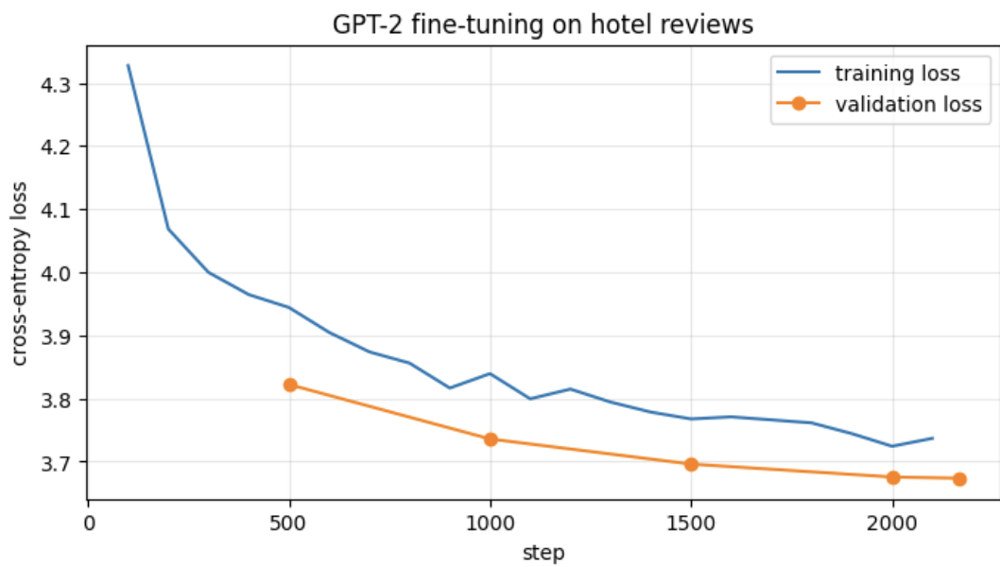

# Fine-tuning GPT-2 on European Hotel Reviews

ILS 651 – Natural Language Processing, Project 4: *Build Your Own Language Model*

I fine-tuned GPT-2 (124M parameters) on 100,000 Booking.com hotel reviews for next-word prediction and text generation. As an extension, I fine-tuned a second GPT-2 model to classify reviews as positive or negative.

## Results

| Metric | Original GPT-2 | Fine-tuned GPT-2 |
|---|---|---|
| Validation loss | 5.21 | 3.67 |
| Perplexity | 183.68 | **39.39** |
| Next-word accuracy | 18.0% | **29.2%** |

Fine-tuning reduced perplexity by **79%**.

**Sentiment classifier (extra credit):** 94.0% accuracy, precision 0.940, recall 0.941, F1 0.940 on 4,000 held-out reviews.

### Experiments (50k-review subset, 1 epoch)

| Experiment | Change | Perplexity |
|---|---|---|
| Baseline | lr 5e-5, block 128, GPT-2 | 43.60 |
| Higher learning rate | lr 1e-4 | 40.34 |
| Shorter context | block size 64 | 42.18 |
| Smaller model | DistilGPT-2 | 53.13 |
| More data (main run) | 100k reviews | 39.39 |

## Example generation

> **Prompt:** "the staff were"
> the staff were superb the location was excellent and the rooms were very quiet the staff were very helpful and friendly the room was very clean ...

## Files

- `Project_4.ipynb`: full code with outputs: preprocessing, training, experiments, evaluation, text generation and sentiment fine-tuning
- `Project_4_Report.pdf`: written report
- `loss_curve.png`: training/validation loss plot

## Data

[515K Hotel Reviews Data in Europe](https://www.kaggle.com/datasets/jiashenliu/515k-hotel-reviews-data-in-europe) (Kaggle, CC0). Not included in the repo because of its size (238 MB). Download it and place `Hotel_Reviews.csv` in the same folder as the notebook.

## Running

Open the notebook in Google Colab with a T4 GPU (Runtime → Change runtime type) and run all cells. Training takes about 15 minutes; the full notebook takes about 45 minutes.

**Stack:** Python, PyTorch, Hugging Face Transformers & Datasets, NLTK, scikit-learn, pandas, matplotlib
